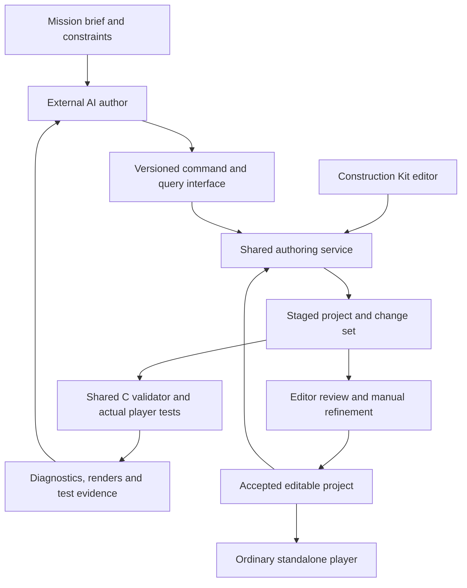

# Plan: AI authoring with the BattleTech Construction Kit

Recorded 2026-10-18 against `266d21f`, with the user's revised Last Beacon
preserved in `bed75e9`.

**Status: AI7a IMPLEMENTED, 2026-10-22.** AI1/AI2 have the versioned
inspection/command contract, transactional CLI, shared editor operations and
command-file exchange described in the [author guide](AI_AUTHORING_GUIDE.md).
The approved next four steps add shared asset discovery, labelled visual
artifacts, native mission analysis and broader seeded ordinary-input tests.
A separate playable authoring lab demonstrates selection, import, a diagnosed
failure and repair. Tests and remaining boundaries are recorded in
[Testing](TESTING.md#ai-authoring-discovery-and-mission-testing--2026-10-19).
AI4 remains bounded to declared routes, initial-party local geometry and small
combat samples. AI5 now adds durable review, protected objects/fields/local
regions, validated partial groups and a local session attached to the editor.
Its Last Beacon completion gate preserves human dialogue, roof painting and
door placement through a generated encounter/road revision and Undo.
See [AI5 verification](TESTING.md#ai5-collaborative-authoring--2026-10-20).
AI6a now adds named regions, persistent typed variables, explicit objective
states and compound conditions, with editor controls and the playable
[Argent Recovery](../examples/argent-recovery/README.md) example.
[Lifecycle and limits](MISSION_STATE.md) are explicit. AI6b/AI6c add
[combat hooks, reserves and escort actors](COMBAT_MISSIONS.md), exercised in
Cairn Passage. AI7a adds [modular sources and deterministic builds](CAMPAIGN_SOURCES.md).
AI7b and AI8 remain proposed. The editor remains the human workspace.

## 1. Intended result

A person describes a game or mission. An AI inspects the project's available
content and capabilities, builds a draft through supported authoring commands,
runs checks and playtests, and returns an ordinary editable project. The person
can revise its maps, artwork, units and events, then ask for a focused revision
that preserves those changes.

Every stage must keep manual editing and normal gameplay usable. New mission
mechanics need editor controls as well as programmatic commands. Generated
games must run without a model, account, network connection or AI subscription.
External AI tools can use the authoring interface; an embedded chat interface
is optional later work.

“In the background” means shared authoring services and explicit background
jobs. The editor shows the job, progress, result and cancellation controls. A
model or continuous generation loop runs only when requested.

The first useful result is a short BattleTech adventure using today's mechanics.
Escorts, reinforcements and larger campaigns follow once their engine support
and testing are available.

## 2. Existing foundation and gaps

**VERIFIED by source inspection**, except where a test result is explicitly
identified. These observations describe the baseline, not completion of this plan.

| Foundation | Current implementation | Work needed for AI authoring |
| --- | --- | --- |
| External content and stable IDs | Project, adventure, definitions and artwork JSON; [schemas](../schemas/); [C project loader](../port/data/project.c) | A complete versioned capability/format reference, bounded queries and schema/loader conformance checks |
| Shared editing state | [ProjectDocument](../tools/editor_model.py): transactions, Undo, staged validation, conflict detection and journaled saves | A stable command service with structured requests/results and whole-batch guarantees |
| Map construction | [Construction operations](../tools/map_construction.py), [world operations](../tools/world_editing.py), [world generation](../tools/scene_tools.py) | Named command wrappers, explicit coordinates, reusable intent and preserved manual details |
| Content reuse | [Unit Library](../tools/unit_library.py), [Pattern Library](../tools/map_patterns.py), construction sets and editable art | Searchable descriptions/tags, dependency queries and compact visual catalogues |
| Verification | Shared C validator; [headless interface](../port/frontend/cli.c); [checkpoints](../tools/playtest_workbench.py); [movement helper](../tests/authored_walk.h) | Scenario assertions, named actions, richer reports, route analysis and reproducible balance samples |
| Human workspace | [Tabbed editor](EDITOR_WORKSPACE.md), shared history, drafts, recovery and [background tasks](../tools/editor_tasks.py) | Reviewable change sets, protected content, live authoring-session integration and resumable AI work |
| Mission logic | Structured events, flags, objectives, win/loss/flee routes and [bounded Lua](../port/core/lua_events.c) | Regions, counters, mission lifecycle hooks and additional supported actions |

Specific gaps identified at the recorded baseline:

- The C graphics loader accepts sprite action `animations`; the current art
  schema omits that property. Audit all supported formats rather than treating
  the existing schemas as a complete contract.
- Lua currently exposes `game.flag`, `game.credits` and `game.command` to choose
  a declared continuation. It is not a general combat or mission-control API.
- Runtime bounds include 16 local maps, 16 encounter definitions, 256 event
  nodes, 64 flags and 32 objectives. Worlds have a shared sector/discovery
  budget. Query actual limits from the installed runtime and show remaining
  capacity; changes to these bounds require an implementation/save audit.
- Some useful operations live beside Tk code. Headless authoring must have a
  dependency boundary that does not require a display or importing GUI modules.
- Validator messages are mainly text. Canonical state contains useful data but
  also numeric handles and compact records that should have named projections.
- Raw pixel scanlines and whole maps are poor routine query results. Separate
  content summaries, selected regions and visual artifacts from complete data.

Last Beacon is a reference for human-authored work. The user's saved maps,
artwork, pixel layers and construction sets are now committed. New generation
tests use disposable copies or a separate example; they must not regenerate
that source project. Subsequent working-tree edits are also preserved separately
from implementation commits.

## 3. Architecture and ownership

Keep the C simulation, resource adapters and validator authoritative. Reuse
Python document/construction/library operations through a small service layer.
The GUI and command-line interface share those operations; neither maintains a
second set of movement, combat or content-validation rules.

Initially, command-line editing works in a private project copy with an expected
revision. Once live integration is delivered, the open editor owns its document:
AI changes enter through its transaction service, including its unsaved state.
Background workers receive immutable snapshots and never mutate Tk objects.

An authoring session has an explicit project, allowed scope and application
policy. A user can review a complete change set or authorize automatic
application within that scope. Do not require confirmation for every tile or
event operation. Conflicts or scope changes produce a specific diagnostic.

Original compatibility remains separately testable. Custom mission behavior
uses declared authored capabilities; the original BLD scripts and campaign
semantics retain their existing path.

## 4. Milestone order

Each milestone has its own implementation commits, verification report and
usable stopping point. Relative size indicates scope, not a calendar estimate.

| Milestone | Deliverable | Depends on | Size | Status |
| --- | --- | --- | --- | --- |
| AI1 | Capability contract, inspection and author guide | Existing project loader | Medium | Delivered |
| AI2 | Shared authoring commands and transactional CLI | AI1 | Large | Delivered |
| AI3 | Searchable catalogues and visual feedback | AI1–AI2 | Medium | Delivered |
| AI4 | Mission scenarios, assertions and playtest reports | AI1–AI2; AI3 for visual reports | Large | Delivered within the recorded route/geometry bounds |
| AI5 | Editor review, protected edits and live sessions | AI2–AI4 | Large | Delivered; local file-inbox transport |
| AI6 | Additional mission primitives and Lua/event support | AI2, AI4–AI5 | Large, split below | AI6a/AI6b/AI6c delivered |
| AI7 | Modular campaigns, reproducible compilation and capacity work | AI2, AI4–AI5; include AI6 formats when available | Large, split below | AI7a delivered; AI7b proposed |
| AI8 | Complete authoring demonstration and delivery | AI1–AI7 | Medium | Proposed |

**First useful AI creation checkpoint: AI1–AI4.** It generates into a separate
copy, supplies test evidence and opens in the existing editor.

**First complete collaborative checkpoint: AI5.** A human changes that result,
and an AI performs a constrained revision while preserving those changes.

AI6 and AI7 build on that workflow. Their internal increments should remain
small enough to review without leaving an unfinished engine transition.

### Delivered discovery/testing pass, 2026-10-19

| Approved step | Delivered boundary | Verification |
| --- | --- | --- |
| 1. Searchable catalogue | Shared project/library/atlas search; numeric and armament filters; editable names/tags/edge notes; dependency and provenance summaries | Catalogue tests; tagged human pickers; library transfer tests |
| 2. Visual feedback | Labelled contact sheets; direction/action strips; map regions with overlays; world/city previews; focused event graphs | Exact pixel/hash/timing tests, read-only checks and inspected exports |
| 3. Mission analysis | Explicit graph/objective diagnostics; C whole-party local navigation, arrivals and deployment checks; editor Problems navigation | Deliberately broken and repaired missions; stale-result and resolved-finding GUI checks |
| 4. Broader gameplay tests | Eight cases/ten new-game runs, three victory seeds, mid-battle save/reload, real retreat, natural defeat, cancellations and a declared low-funds fixture | Native routes, suite reports, Windows routes under Wine and full regressions |

`tools/authoring_demo.py` records a separate end-to-end lab: find/import a
Firefly, select industrial assets and animated terrain, export visual evidence,
break deployment, diagnose it, repair with a scoped revision-checked batch and
rerun only the three affected victory seeds. Existing games and libraries are
read-only inputs. It uses the normal player after generation.

Not established by these tests: arbitrary Lua/condition reachability, world-wide
navigation, all later party compositions, arbitrary checkpoint entry setups or
general combat balance. These remain AI4 extensions rather than implicit
promises of complete mission proof. Native Windows editor interaction remains
unverified. The subsequent AI5 increment is recorded below.

## 5. AI1 — Contract, inspection and author guide

### Scope

- Establish an authoring API version separate from project schema, content
  version and save format. Report runtime/build identity and required features.
- Supply read-only queries for project summary, IDs, definitions, usages,
  maps/regions, mission routes, dependency/provenance inventory and capacities.
- Return explicit coordinate spaces: map tiles, world tiles and movement
  positions. Return names with IDs; numeric runtime handles remain diagnostic.
- Audit schemas against accepted C data, including animations, vehicles, worlds
  and services. Use shared operation descriptors to generate command reference
  material; retain C validation for semantic rules that schemas cannot express.
- Define machine-readable errors with stable code, severity, object ID, field
  path and location where applicable. Human-readable messages remain available.
  Multiple independent diagnostics can be collected; malformed structural input
  may still require an initial error to be fixed before further analysis.
- Write a concise author guide with supported recipes, complete small examples,
  asset dependencies, limits and test commands. Clearly separate current
  capabilities from proposals and historical evidence.

### Completion gate

An agent given only the author guide and inspection command can identify the
installed capabilities, starting party, mission branches, available units,
animated tiles and remaining event/map capacity in a supplied project.
Inspection changes no files and handles missing optional asset dependencies
with a useful unavailable result.

Schema/loader fixtures cover supported and rejected examples, including the
currently missing animation-track description. Query output is stable,
versioned, bounded and usable on a headless host.

### Implementation starting points

[project.c](../tools/project.c), [schemas](../schemas/),
[editor dependencies](../tools/editor_dependencies.py),
[definition loader](../port/data/definitions.c),
[adventure loader](../port/data/adventure.c) and the authoring documentation.

## 6. AI2 — Shared authoring service and commands

### Scope

Expose named operations for:

- Project creation, validation, export and staged saving.
- World/jigsaw/map creation, city placement, terrain painting and pattern use.
- Building/wall/road footprints, height, style, doors and retained detail edits.
- Character, unit, weapon/equipment and library import operations.
- Encounter placement, dialogue, event connections, services and objectives.
- Art import/cloning, sprite/frame definitions and animation timing.

Give each operation a schema, description, read/write scope and example. Accept
JSON through files or standard input, and emit JSON results; do not require
shell quoting of large descriptions or raw image scanlines. Images enter
through existing import/processing functions with explicit frame dimensions.

Batch related edits into one candidate document. Resolve dependencies, check
scope and budgets, validate the complete result, then apply atomically. A
rejected or cancelled batch leaves the project and history unchanged. A dry run
returns the same proposed changes without applying them. Successful batches
have IDs, base/result revisions, labels and changed-object summaries.

Retries must be identifiable and repeatable: the same completed request cannot
create a second copy. Persist enough request outcome information to distinguish
an interrupted application from a new operation. Omitted IDs can be returned
as stable generated IDs; explicit IDs allow deterministic construction.

Move GUI commands onto the service incrementally. Existing low-level document
transactions remain the storage/Undo foundation. Validate a connected batch
as a whole so temporary references between newly created objects are allowed.

### Completion gate

One batch creates a playable briefing, a town with a building entrance, a shop,
an encounter, victory/defeat/retreat branches and an objective/reward.
The result opens in the ordinary GUI and passes C validation.

Check dry run, duplicate request, invalid references, insufficient capacity,
cancellation, crash recovery, external modification and one-step Undo/Redo.
GUI and CLI operations produce equivalent gameplay data and construction
metadata. An unchanged save preserves the existing package identity.

### Implementation starting points

[editor model](../tools/editor_model.py), [history](../tools/editor_history.py),
[adventure edits](../tools/adventure_editing.py),
[construction edits](../tools/construction_editing.py),
[map construction](../tools/map_construction.py),
[unit imports](../tools/unit_library.py) and [art edits](../tools/art_editing.py).

## 7. AI3 — Content discovery and visual feedback

**Implemented for the approved pass.** The guide documents the catalogue,
annotation operation and all exported artifact commands. The shared editor
catalogue and pickers expose the same search semantics. Additional asset kinds
can extend this interface without replacing it.

### Scope

- Search units by class, movement, armament, mass, price, role and dependency.
  Derived statistics remain distinct from authored descriptions or estimated
  tactical roles.
- Add descriptions/tags for terrain, tiles, construction sets, patterns,
  portraits and animations. Include visual theme, connecting edges, collision,
  intended use, frame count/timing, source and dependency status.
- Expose library dependency closure: importing a unit also resolves its
  weapons, equipment, presentation and attribution through the existing rules.
- Render contact sheets with exact IDs and names; map regions with optional
  collision, entrances, formations, selected-object and world/city overlays;
  event-graph previews; and short animation previews or frame strips.
- Keep large pixel arrays out of ordinary query responses. Return bounded
  summaries and artifact paths keyed by content hash. Reloaded artwork
  invalidates the corresponding previews.
- Provide the same tags/search improvements in human asset pickers. Metadata
  must be editable; generated descriptions are suggestions, not authority.

### Completion gate

An agent can find a light missile unit, compatible industrial building parts,
an animated force field and a road pattern, then place them without guessing
atlas indices. A contact-sheet selection resolves to the same graphic in the
editor and player. Previewing leaves history and game data unchanged.

Verify animated copies retain frames/timing, imports retain dependencies and
provenance, and CHI-dependent art is distinguishable from independent art.

### Implementation starting points

[Unit Library](../tools/unit_library.py), [tile previews](../tools/editor_tiles.py),
[tile animation](../tools/tile_animation.py), [Pattern Library](../tools/map_patterns.py),
[construction metadata](../tools/construction_editing.py) and player rendering.

## 8. AI4 — Repeatable mission tests and reports

**Implemented within the delivered boundary above.** Current scenarios start
new games or explicit validated fixtures; `checkpoint` verifies exact save/load
inside that run. The suite can rerun selected cases. Whole-game reachability,
arbitrary checkpoint-start scenarios and broader balance policies remain
future extensions of the following full scope.

### Scope

Define scenario files with a project revision, named starting setup, explicit
seed, bounded steps, assertions and requested artifacts. Scenario setup may
create a validated fixture or resume a matching checkpoint; reports distinguish
controlled fixture tests from a complete ordinary gameplay route.

Build higher-level test actions over real simulation inputs: travel to a named
entrance, select an identified choice, inspect an object, save/reload and run a
battle under an explicit tested control policy. Use the movement rules for the
whole party and each supported movement type. A test convenience must not
silently teleport units, award victory or change flags to make a route pass.

Assertions cover objective transitions, party/unit state, payments, rewards,
encounter outcomes, return destinations, cancellation and once-only effects.
Expose named state projections and event/mission traces instead of requiring
agents to interpret compact byte records.

Add lint/analysis for unreachable entrances and spawn areas, obstructed
formations, invalid deployment, dead event branches and suspicious synchronous
cycles. Static graph analysis cannot prove arbitrary Lua or all gameplay
conditions; label warnings and unknown coverage accordingly.

Run small, bounded combat samples across documented seeds and initial forces.
Report completion rate, turns, losses, damage and expenditure with the sample
size and control policy. Balance conclusions remain estimates for that sample.

Failures return stable diagnostics, object IDs, coordinates, shortest available
reproduction steps, state/trace and useful screenshots. Captures include held
dialogue and animated-frame evidence where those features changed.

### Completion gate

The AI2 adventure completes by ordinary input. Victory, defeat, retreat, decline,
repeat visits, unaffordable services and save/reload paths have explicit results.
Deliberately blocked deployment, repeated rewards and broken event connections
are diagnosed. An AI can use a report to repair a broken mission and rerun only
the affected scenario before the relevant regression set.

Tests have time/tick limits and cancellation. Checkpoint validity is tied to
its exact compiled content. Changed missions regenerate/replay their setup or
use an explicit supported migration; they never silently load stale state.

### Implementation starting points

[CLI/headless player](../port/frontend/cli.c),
[checkpoint workbench](../tools/playtest_workbench.py),
[authored navigation test helper](../tests/authored_walk.h),
[event observer](../port/core/events.c) and existing campaign/save tests.

## 9. AI5 — Review, preserve manual work and integrate live sessions

**Delivered 2026-10-20.** **Project → Changes and protection** supplies paired
maps, object/field comparisons, event routes, dependencies and checks on the
exact candidate. Named object/field/region rules, dependency groups and explicit
exceptions share the transactional command service. Compatible manual detail
survives; displaced detail is reported.

**Project → Local authoring session** accepts snapshot/proposal jobs through a
local JSON-file inbox. It defaults to review, with opt-in application within
scope. It includes pending valid forms, revisions, visible jobs, cancellation,
retained artifacts and shared Undo. The editor owns publication; no embedded
model, provider connection or network server is required.

The completion gate passes on a copy of the user's Last Beacon: actual GUI
dialogue/roof/door edits, an external CLI road/encounter proposal, protected
review and one-step Undo, plus a complete native gameplay route on the revised
copy. Stale jobs, invalid fields, queued/running cancellation, interrupted save,
review/tab/editor reopening, protection-form recovery, project replacement and
separate Unit Library publication are exercised. See the
[guide](AI_AUTHORING_GUIDE.md#review-changes-and-preserve-human-work) and
[evidence/limits](TESTING.md#ai5-collaborative-authoring--2026-10-20).

### Scope

- Add a Changes/review view with a description, affected objects, before/after
  maps and event routes, dependency changes and linked validation/test results.
- Support Apply, Discard and request/review of a narrower revision. Partial
  acceptance uses dependency-complete groups and validates the resulting
  combination; it cannot leave half an encounter or missing artwork.
- Let users preserve objects, map regions or selected fields during generation.
  Support intent such as “keep this dialogue” or “keep layout; adjust enemy
  composition.” Show conflicts and explicit override controls.
- Keep footprints, style assignments, pixel layers, event graph layout, tags and
  human annotations as authoring data. Regeneration must retain compatible
  manual tile details and report displaced details when geometry changes.
- Attach an optional local tool session to the open document. It reads a
  deliberate snapshot including drafts, uses expected revisions and applies
  through shared history on the GUI thread. Closed-project CLI work remains
  available independently.
- Show queued/running jobs, cancellation, artifacts and restart/recovery status.
  A model failure leaves a reviewable draft/result; it cannot strand Save or Play.

Each session records the brief, constraints, allowed scope, base revision and
result. Applying content to the shared Unit Library is a separate explicit
scope from importing a library unit into a game.

### Completion gate

Generate into a copy of Last Beacon. A person edits dialogue, paints roof
details and moves a door in the GUI. An agent then revises a selected encounter
and road without altering the protected human edits. Review highlights the
actual changes; one Undo reverses the accepted batch.

Exercise edits made while the job runs, invalid pending GUI fields, cancellation,
interrupted save, reopening recovery, closing tabs and project changes. Stale
results are rechecked or reported; there is no silent overwrite. Manual
authoring and playtesting still work with no AI tool session connected.

### Implementation starting points

[workspace](../tools/editor_workspace.py), [session/drafts](../tools/editor_session.py),
[background jobs](../tools/editor_tasks.py), [recovery](../tools/editor_recovery.py),
[history](../tools/editor_history.py) and the construction metadata model.

## 10. AI6 — Richer mission mechanics

Deliver in three independently playable increments. Each needs data validation,
editor controls, commands, runtime behavior, save support and scenario tests.

### AI6a: regions, mission state and objectives

**Delivered 2026-10-20:** named map regions, enter/leave conditions, typed persistent mission
variables/counters and explicit objective states. Document lifecycle, repeat
behavior and event order. Start with reach/extract, collect/count and
multi-condition objectives; keep existing flag-based projects working.

The [mission reference](MISSION_STATE.md) records the implemented rules.
Argent Recovery passes success, abandonment, repeated crossings, combat
victory/defeat/retreat and saved continuations. The manual editor supports
region drawing, variable/objective forms, conditions, Undo and draft recovery.
See [verification](TESTING.md#ai6a-mission-state-and-editor-repairs--2026-10-20).

### AI6b: combat lifecycle and reinforcements — delivered 2026-10-21

Implemented hooks for combat start, round boundaries and completed unit
destruction, plus named unit groups, survival conditions, timers and bounded
reinforcement requests. Atomic spawn placement uses native occupancy/terrain
rules and explicit failure/retry routes. Notifications follow completed
simulation/presentation events, including the existing destruction/audio order.

### AI6c: escort and defence — delivered 2026-10-21

Implemented friendly/neutral mission actors, affiliation and targeting rules,
waypoints, transport survival and extraction conditions. The native engine owns
turns, control, defeat, retreat and saved continuations. Cairn Passage's protected
vehicle uses the existing movement planner and terrain rules; the declared
success, transport-loss and retreat scenarios pass. [Combat semantics and
limits](COMBAT_MISSIONS.md) and [verification](TESTING.md) describe the bounds.

Structured event nodes and bounded Lua use the same named queries/actions.
Lua requests supported work; the engine owns waiting, scheduling, simulation
and saved continuation. Script memory/instruction budgets remain explicit.

### Completion gate

Ship one tested example for each increment: extraction/count objective,
timed defence with reinforcements, then vehicle escort. Test success, failure,
retreat, repeated triggers, occupied spawns and save/reload at lifecycle
boundaries. Original campaign/regression scenarios retain their behavior.

## 11. AI7 — Modular source and campaign capacity

### AI7a: editable modules and deterministic builds

**Delivered 2026-10-22.** Optional `SOURCE.json` projects compile to existing
native packages. GUI/CLI Save updates source-owned objects and text; Play,
launcher and Build use validated compiled packages. Source paths accompany
diagnostics and review snapshots. Stable ordering, source revisions, journal
recovery, Undo/Redo, provenance and independent source/runtime identity are
tested. The two-planet Cairn recipe compiles reproducibly and completes both
missions/checkpoints on Linux and Windows under Wine. Existing package formats
and runtime limits are unchanged. [Guide](CAMPAIGN_SOURCES.md),
[verification and bounds](TESTING.md#ai7a-campaign-source-modules--2026-10-22).

Offer an optional authoring source layout with separate mission, map,
definition and text files, plus references to artwork and editor metadata.
Compile it into the normal validated game package. Existing package directories
remain editable and playable without conversion.

Choose one source of truth per project. For a source project, GUI and command
edits update source objects; compiled files are outputs. Record generated-object
locations so diagnostics and review navigate back to their source. Imported
legacy projects receive a deliberate conversion rather than two conflicting
editable copies.

Keep stable IDs, deterministic ordering/serialization, dependency closure and
source attribution. Mission briefs, protected areas, layout and other
authoring-only notes must not invalidate gameplay saves by themselves. Gameplay
content changes still follow explicit package/save compatibility rules.

### AI7b: measured capacity extensions

Use generated realistic campaigns to identify actual constraints. Expand local
maps, encounter/objective/event/variable budgets only after auditing handle
widths, sentinels, serialization, discovery, UI and runtime memory. Report the
installed limits and version requirements through AI1.

This is not a blanket replacement of constants: original compact adapters and
old saves need their own compatibility path. Introduce a versioned authored
representation where widening old structures is unsuitable.

### Completion gate

A multi-mission, multi-planet project builds reproducibly from source, opens in
the editor, survives manual edits/export/reopen, and reports failures at the
right source object. Equivalent no-op builds preserve identity. Test a project
above the selected previous limit and reject one beyond the new stated limit.
Document migration/refusal behavior with real saved fixtures and memory results.

## 12. AI8 — Demonstration, adapters and delivery

### Scope

- Create a separate BattleTech campaign example using a recorded brief,
  explicit dependencies and the command API. Preserve Last Beacon as the
  user's authored reference; also maintain a small independent test fixture.
- Include a town/service loop, branching contract, ordinary combat objective,
  and examples of the AI6 mechanics. Reuse tested mission recipes with explicit
  parameters; retain human-readable expanded maps/events in the editor.
- Supply the author guide, command reference, recipes, scenario examples,
  asset catalogue instructions and one-command generation/check/play workflow.
- Package the authoring CLI with the Construction Kit on Linux and Windows.
  Keep the tool interface usable by different external AI applications. Any
  assistant-specific transport is a thin adapter over the same command schemas.
- Document model configuration only for the optional authoring connection.
  Normal editing, generated packages, validation and playback remain offline.

### Completion gate

Starting from the brief, an AI creates the example through supported tools,
gets a useful failure report, repairs it, and supplies a validated playable
package with scenario results and visual evidence. A human revises it in the
GUI, then the AI makes a constrained follow-up without losing those edits.

Repeat generation with the recorded tool inputs to reproduce its content;
do not claim that free-form model sampling itself is deterministic. Run the
exported game with the authoring tool/model unavailable. Verify installation,
paths with spaces, dependency reporting and supported platform workflows.

An embedded chat panel, additional model adapters and conversational polish can
follow this gate without changing the game formats or authoring semantics.

## 13. Proposed command contract

The following dotted names describe conceptual service families. Use the actual
CLI subcommands and edit-operation names in the [guide](AI_AUTHORING_GUIDE.md)
and [generated reference](AUTHORING_COMMANDS.md); this table is not a CLI syntax
reference. AI5 implements the review/apply and local job families through
`author.py review`, `author.py protection` and `author.py session`.

| Family | Example operations |
| --- | --- |
| Discover | `capabilities`, `project.describe`, `asset.search`, `object.get`, `object.usages` |
| Edit | `project.create`, `map.paint`, `building.draw`, `entrance.place`, `unit.import`, `event.connect`, `objective.define` |
| Inspect visually | `render.map`, `render.contact_sheet`, `render.animation`, `render.events` |
| Check | `project.validate`, `mission.lint`, `scenario.run`, `report.get` |
| Review/apply | `changes.preview`, `changes.apply`, `changes.discard`, `job.status`, `job.cancel` |

For a mutating batch, carry `api_version`, `request_id`, project identity,
`expected_revision`, allowed scope, label and operations. Dry-run and apply
use the same operation definitions. Responses include status, resulting
revision when applied, created/changed IDs, diagnostic records and artifact
references. Long jobs return an ID; polling/cancellation works without keeping
a terminal interaction open.

Format/capability errors must distinguish unsupported mechanics, missing
dependencies, stale revisions, invalid content and exhausted budgets. A model
must be able to discover that an escort command is unavailable in an older
runtime before generating a script that depends on it.

Keep ordinary summaries small. Query individual objects or rectangular map
regions; paginate catalogues. Bulk art import and complete project export are
explicit operations. Never require an agent to rewrite millions of pixel hex
digits merely to move an entrance.

## 14. Verification, compatibility and efficient execution

At each milestone:

1. Define its representative authoring/gameplay journey and expected result
   before implementation. Reuse existing fixtures, loaders and renderers.
2. Test new contracts/model transformations with meaningful valid/invalid cases;
   run real C gameplay checks for changed rules. Record changes to behavior.
3. Run relevant GUI journeys for manual/AI parity, Undo, drafts, save/reopen,
   recovery and visible errors. A headless pass alone does not verify the GUI.
4. Run affected end-to-end scenarios, including save/load, then the appropriate
   regression suite. Re-run broad suites when changes justify them, not after
   every small documentation or UI adjustment.
5. Build relevant Linux/Windows targets separately, at most two compiler jobs.
   Distinguish native Windows UI, cross-build and Wine results. Report unavailable
   platform checks as UNKNOWN.
6. Use disposable project copies and isolated playtest saves/artifacts. Preserve
   the original game, Last Beacon, shared library entries outside the requested
   scope and both reference directories. Compare the existing reference manifest.
7. Update PROJECT_STATUS, TESTING and OPEN_QUESTIONS with the completed boundary,
   measured results and remaining limitations; commit each verified increment.

Pin runtime/content revisions and seeds in reports. Bound model/tool jobs,
simulation ticks, output size and concurrent workers. Record timing and memory
on a declared fixture so changes to responsiveness can be assessed. Failed
jobs retain enough evidence to resume without repeating the whole campaign.

Tests establish particular properties and routes. Static reachability checks
do not prove every state is reachable, AI combat samples do not prove balance,
and visual checks do not prove gameplay. Preserve these distinctions in reports.

## 15. Decisions and next implementation step

Decisions established by this plan:

- Retain and improve the full manual editor throughout.
- Share commands, validation and simulation between GUI, CLI and AI tools.
- Keep original compatibility and authored extensions explicit.
- Start with a model-independent CLI and ordinary editable projects.
- Preserve human changes through revisions, scope, metadata and review.
- Make the first demonstrated mission use existing mechanics; add engine
  capabilities through separately verified increments.

Remaining implementation choices: measured capacity targets and compatibility
representation (AI7b), and useful external assistant transports (AI8). Source
modules now use the documented `btp-campaign-source-v1` format. No AI provider
choice is required for ordinary editing, compilation or gameplay.

**Next proposed milestone: AI7b — measured campaign capacity extensions.**
AI6b/AI6c now supply round hooks, atomic reinforcement groups, scripted outcomes,
friendly/neutral actors and terrain-aware waypoints. Cairn Passage demonstrates
defence and escort with declared native success/loss/retreat scenarios. Construction
coverage and shared-library styles support all roof masks, wall levels and road
junctions. AI7a is delivered; AI7b and AI8 remain future work. Source compilation
does not raise runtime limits.

The separately authorized [shared Construction Library](CONSTRUCTION_LIBRARY.md)
is delivered: building, wall and road definitions and stored patterns transfer
their tile/art dependencies between projects. The editor, catalogue, labelled
previews, command imports and reviewed/live authoring sessions share it.

World creation, seeded jigsaw generation/painting, terrain patches, town-map
placement and composed world previews are already exposed to AI tools.
AI7b covers larger campaign/capacity work; world-wide traversal verification is
still an AI4 extension. Keep those distinctions visible rather than advertising
an unbounded planet/campaign generator.
