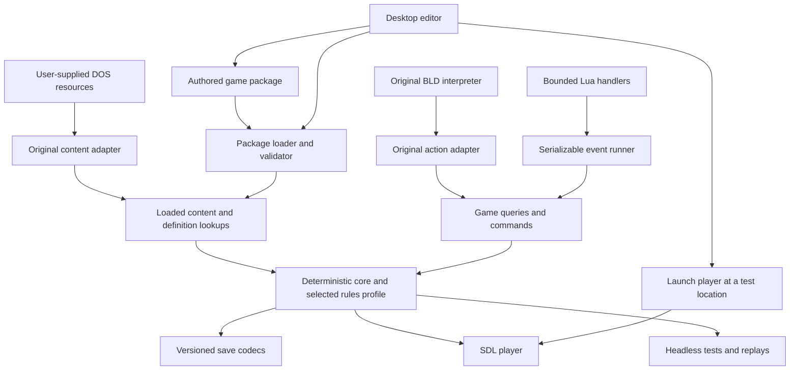

# Plan: reusable runtime, custom games and an editor

Recorded **2026-10-16**, against implementation commit `c29ea75`.

**Status: M5-P1–P5 implemented and verified within documented bounds.** This document
records the discussion about additional mechs, external game data, BLD/Lua
scripting and a Windows/Linux game editor. Shared loading, semantic unit
lookups, original action dispatch, persistence isolation and an offline
schema/sample are in place; see [preparation evidence](M5_PREPARATION.md) and the
[content inventory](CONTENT_INVENTORY.md). Runtime packages, Lua and the editor
remain proposed. Original fidelity work is tracked in
[PROJECT_STATUS.md](PROJECT_STATUS.md).

The [five preparation increments](#9-preparation-that-can-be-done-now) record
the completed scope. The [later milestones](#10-subsequent-milestones-and-dependencies)
and [verification gates](#11-verification-and-delivery-rules) describe next work.

## 1. Intended result and scope

Develop the current independent recreation into a player for games in the same
broad family: tile-based exploration, towns and interiors, party development,
dialogue, shops, quests and tactical combat. Supply a desktop editor with which
someone can create a complete game, including its own assets and scripts,
without modifying or recompiling the engine.

The first useful expansion is a larger mech catalogue. The eventual authoring
experience should resemble Unlimited Adventures: paint maps, place characters
and events, fill in properties, connect conditions and outcomes, then play the
result. Lua supplies more elaborate behavior when forms and event nodes are
insufficient.

The ScummVM comparison describes separating a reusable player from game data.
Supporting an unrelated historical game's executable or scripting system would
still require a separate implementation and research effort. This plan targets
new games designed for our runtime, plus continued support for the existing DOS
game resources. It does not turn BtechPort into a universal DOS-game interpreter.

Keep two explicit uses of the same maintained codebase:

- **Original compatibility profile:** the current campaign, original resource
  adapters, BLD behavior, graphics, sound, saves and documented corrections.
- **Custom game profile:** authored packages, named definitions and events, and
  deliberately selected rules and presentation. An expanded-mech campaign that
  depends on the original assets is also a custom profile and declares that
  requirement; it is not a standalone asset-free replacement for those files.

Preparation should preserve the current game, including known behavior and
documented limits. It should not silently change the original rules in pursuit
of a cleaner general engine. Supporting more chassis does not imply increasing
party size, changing combat rules or rewriting the renderer at the same time.

## 2. Repository baseline before preparation

These are **VERIFIED source observations** at the commit above. They establish
implementation structure, not universal fidelity to the original executable.
For owners after P1–P5, see the [current content inventory](CONTENT_INVENTORY.md).

| Area | Present implementation | Consequence for the transition |
| --- | --- | --- |
| Core and frontends | C11 simulation, SDL2 player, headless player and deterministic inputs; see [CMakeLists.txt](../CMakeLists.txt) and [game.h](../port/core/game.h) | Retain the core and verification tools; no language or engine rewrite is necessary |
| Resource loading | [resources.c](../port/data/resources.c) loads named original maps, BLDs, graphics and animations into [BtpResources](../port/data/resources.h) | Put an explicit original-content adapter around these assumptions |
| Startup | [headless.c](../port/frontend/headless.c) and [sdl.c](../port/frontend/sdl.c) duplicate the resource/dialogue/combat/world loading sequence | A shared loader is a small, useful first preparation change |
| Extracted data | [prepare_combat.py](../tools/prepare_combat.py), [prepare_talk.py](../tools/prepare_talk.py) and [prepare_world.py](../tools/prepare_world.py) prepare local binary caches | Much data is already outside the executable we build, but depends on the original executable and its layouts |
| Mechs and combat | [combat_rules.h](../port/core/combat_rules.h) uses 125-byte mech records, fixed original tables and a 24-actor combat limit | Separate authored definitions from mutable instances; isolate original record access |
| Party | [game.h](../port/core/game.h) represents eight people and four owned mech slots | Catalogue growth and party-capacity growth are separate projects |
| Appearance and refits | [animation.c](../port/core/animation.c), [effects.c](../port/core/effects.c) and [service.c](../port/core/service.c) contain mech-tag/atlas assumptions and fixed refit recipes | New chassis need presentation and service metadata as well as combat statistics |
| Story | [script.c](../port/core/script.c) interprets BLD; [game.c](../port/core/game.c), [story.c](../port/core/story.c) and service modules handle game-specific native actions | Preserve BLD semantics while separating story dispatch from reusable operations |
| Saves | State encoding, migrations and validation are largely in [game.c](../port/core/game.c); file envelopes and original saves have [separate readers](../port/data/save.c) | Extract the existing codec before introducing a new package-aware save format |
| Maps | [world.c](../port/core/world.c) combines generated landscape, local maps, story transitions and terrain rules | Custom maps need explicit placement, collision and overlay metadata, not original map-number conventions |

That baseline used BTPe/v40 saves, a 20,480-byte payload, and BTTA/v24,
BTCB/v11 and BTW3 caches. Verification recorded at that point included 56 native,
56 sanitizer and 56 Windows/Wine suites, plus saved campaign routes and SDL
checks. These are previous results, not tests rerun for this plan. See
[TESTING.md](TESTING.md) and [the portability report](M4_PORTABILITY_SWEEP.md).

## 3. Target boundaries

The following diagram is a target, not a description of today's module layout.



Separate four things which are currently often adjacent:

1. **Content definitions:** immutable chassis, weapons, terrain, maps, dialogue,
   sprite sets, sound cues and event programs.
2. **Game instance:** mutable party, unit damage, inventory, RNG, exploration,
   quest variables and pending interactions.
3. **Rules:** movement, collision, attacks, damage and other algorithms. Keep
   these in C initially; expose supported parameters and named operations.
4. **Presentation:** rendering, interface layout, animation and sound playback.
   A script requests an operation; the engine owns its timing and completion.

Use small interfaces where there are actual callers. An original-only lookup
is a legitimate first implementation of a future content interface. Avoid a
large speculative plugin API, a full entity-component rewrite or parallel
copies of the simulation in the player and editor.

The original profile retains documented arithmetic, RNG order, terrain quirks
and presentation timing. Custom rules should not inherit an accidental original
memory-layout dependency merely because both profiles share an implementation.
Any intentional divergence needs a named policy and tests for both profiles.

## 4. External data and game packages

### 4.1 What to externalize

Not every C constant should become a configuration option. Externalize things
an author needs to define or select; retain invariant algorithms, bounds checks
and internal implementation details in code.

| Content | Proposed authoring representation | Details needed beyond a name |
| --- | --- | --- |
| Mechs, weapons, equipment | Versioned JSON definitions | Statistics, component locations, movement, heat/ammo rules, prices, availability and presentation references |
| Characters and encounters | JSON definitions | Skills, inventories, faction, recruitment, formations, spawn restrictions and encounter conditions |
| Shops and services | JSON stock/service definitions plus events | Prices, eligible recipients, repair/refit recipes, stock conditions and conversation hooks |
| World and local maps | JSON metadata plus tile/layer data | Dimensions, origins, entrances, terrain, overlays, encounter regions and event triggers |
| Dialogue and menus | Named text/choice resources | Speaker, text, choices, presentation style and outcomes; avoid embedded English as identity |
| Quests and interactions | Structured event documents; optional Lua modules | Conditions, branches, persistent variables, pending operations and completion handlers |
| Art and animation | PNG plus animation metadata | Frames, durations, directions, anchors, palettes, firing/hit/wreck states and inspection images |
| Audio | WAV for the initial custom format, with named cues | Ordered playback, completion rules, loops and associations with actions/animations |
| Interface and startup | Profile metadata and assets | Fonts, borders, colors, title/intro, starting party/map and ending sequence |

These formats are proposals. PNG/WAV decoders and the package parser would be
new dependencies or implementation work; they are not current runtime features.
Keep the initial custom display at 320 by 200 and the current basic rules.
Higher resolution, arbitrary unit shapes and a fully configurable interface
are later extensions, not prerequisites for a first independent game.

Original ICN/CMP/ANM/BLD/MTP and speaker programs remain supported through the
original adapter. Authoring new data must not require packing it into those
formats, editing BTECH.EXE or redistributing extracted caches.

### 4.2 Package layout and identity

Start with one directory per game. A convenient archive/export format can follow
after directory loading works. One active package is enough initially; general
mod layering and dependency resolution can wait.

Illustrative layout, **not yet a supported format**:

```text
harbour-demo/
  game.json
  definitions/
    mechs.json
    weapons.json
    characters.json
    shops.json
  maps/
    coast.json
    settlement.json
  events/
    campaign.json
  scripts/
    rescue.lua
  assets/
    sprites/
    portraits/
    tiles/
    fonts/
    audio/
  text/
    en.json
  credits.json
```

Illustrative `game.json`:

```json
{
  "schema_version": 1,
  "game_id": "harbour-demo",
  "title": "Harbour Patrol",
  "content_version": "0.1.0",
  "rules_profile": "btp-tactical-v1",
  "engine_api": 1,
  "entry_event": "harbour-demo:begin",
  "definitions": ["definitions/mechs.json", "definitions/weapons.json",
                  "definitions/characters.json", "definitions/shops.json"],
  "maps": ["maps/coast.json", "maps/settlement.json"],
  "events": ["events/campaign.json"],
  "script_modules": ["scripts/rescue.lua"],
  "text": ["text/en.json"],
  "credits": "credits.json"
}
```

Use stable namespaced identifiers such as `harbour-demo:scout`, independent of
display names, file order, original numeric slots and the first letter of a
mech name. Resolve these into compact runtime handles when loading. Serialize
stable identity, or an explicitly saved handle-to-ID table, so reordering JSON
does not change which mech a save contains.

Keep schema version, game ID, content version, rules profile and engine API
version distinct. Generate a content fingerprint from a canonical package
inventory; package versions alone do not prove two installations match.

Validation must report file, definition ID and field/event node. Reject duplicate
IDs, missing references, invalid dimensions, unsupported capabilities, invalid
equipment and unusable animation sets before play. Resolve asset paths relative
to the package, reject escapes outside it, and check case consistently on Linux
and Windows. Content loads into a temporary owned context; failed loading must
leave the current game intact. Authored source is authoritative; any binary
cache is disposable, versioned and invalidated by source changes.

### 4.3 Maps require explicit semantics

Give terrain its own movement and visibility properties, separate from the art
tile index. Specify local-map world origins, overlay masks, entrances and region
transitions. The final composed terrain must drive both movement and drawing,
including islands and ruined-city overlays. Test every formation member and
combat actor against that same resolved terrain.

Start custom packages with stored maps and authored placement. Reusable
procedural generation or a jigsaw-piece editor can follow once the map contract
works; keep the verified original world generator behind its adapter. Do not
make a new author know the Citadel's coordinates or original map numbers.

## 5. Adding many more mechs

### 5.1 Definitions and instances

An immutable **mech definition** describes a chassis/loadout template:

- Stable ID, display name, weight and supported movement modes.
- Component layout, armor/structure maxima, heat capacity and dissipation.
- Weapon mounts, equipment compatibility, ammunition and initial loadout.
- Prices, repair/refit options, salvage policy and encounter availability.
- Map sprite/animation set, directions/anchors, combat effects, wreck and
  inspection illustration. A shared art set must be an explicit choice.

A **mech instance** references that definition and stores what changes during
play: remaining armor, damaged components, heat, ammunition, installed equipment,
pilot and location. Refit changes installed equipment or a declared variant;
it must not mutate the definition shared by every mech of that type.

Initially expose semantic views of original 125-byte records. Preserve their
raw bytes and current write behavior for original saves and comparison tests.
Introduce richer custom instances behind the same useful accessors later,
rather than replacing all records and persistence in one change.

### 5.2 Expected difficulty

| Expansion | Work after the definition pipeline exists |
| --- | --- |
| More conventional chassis with existing weapons and movement | Primarily data, art, balancing and lifecycle verification |
| Many variations of an existing chassis | Small if variants and refit compatibility are explicit |
| New weapon behavior or equipment effect | Core rule, AI, targeting, UI, save and script API work, then data |
| Flight, transformation or substantially different physical layouts | A new capability project, not just another JSON entry |
| More than four owned mechs, eight people or 24 combat actors | Separate state, UI, formation, performance and save-format changes |

The first external model is much more work than the twentieth. A catalogue of
dozens or hundreds is a sensible design goal, but it needs measured limits and
stress tests before being claimed as supported. Larger catalogues should not
allocate complete combat/audio state for each definition or put large tables
on the Windows stack.

### 5.3 First acceptance set

For the later independent demonstration, use three independently authored models: a fast scout, a heavily armed ground
unit and a jump-capable raider. They should exercise different existing
capabilities without requiring a new combat system. Use newly created art or
clearly marked local development placeholders; original artwork is not part of
the distributable demonstration.

For each, verify acquisition, pilot assignment, movement, inspection, attacks,
damage, repair, ammunition/refit, salvage where applicable, and save/reload.
Check animations for multiple friendly and enemy units, including wreck timing.
Adding another conventional model after this gate must require only package
content changes, with no new C switch case keyed to its identity.

## 6. BLD, structured events and Lua

### 6.1 What BLD can do

The current interpreter supports text and layout requests, menus and Yes/No
choices, waits, animation requests, byte-sized story state, arithmetic on those
bytes, branches/jump tables, cash/conditions/recruitment and native calls. That
can express substantial branching dialogue and quests. However, many services,
story transitions and combat actions work because C implements the native
action, not because the BLD language itself describes all their rules.

The current code recognizes native action IDs 1 through 47. Dispatch also
depends on the building/game context; an ID alone is not a general scripting
API. Other present constraints include fixed menu identities, a 100-byte story
window, 16-bit instruction positions and a 256-instruction execution budget per
interpreter run. Preserve their original meanings in the compatibility path.

New native actions or opcodes are technically possible. An extended format
would need explicit identification/versioning, tooling, diagnostics and save
rules; new files would not thereby work in the original DOS executable. Keep
unknown operations as errors. An extended BLD dialect should be optional future
work driven by a concrete need, rather than the primary new authoring language.

### 6.2 Recommended combination

| System | Role |
| --- | --- |
| Existing BLD interpreter | Run original scripts without translation or semantic changes |
| Structured event runner | Most new dialogue, menus, conditions, rewards, transfers, shops and encounters; also the editor's visual event model |
| Embedded Lua | Named handlers for custom decisions and behavior beyond the standard nodes |
| C engine API | Authoritative queries and validated commands shared where semantics agree |

Lua is designed to be embedded and to call functions registered by a C host.
That makes it a practical candidate for the existing core; the usable power
comes from the game API we expose, not merely from adding a language. Pin a Lua
version and build options when implementing the prototype, rather than depending
on whichever library is installed. See the [Lua reference manual](https://www.lua.org/manual/5.4/manual.html#1).

Expose named operations such as showing dialogue, offering choices, checking
party/equipment, transferring credits/items, recruiting, starting a battle,
moving to a map and playing a sequence. Keep original native ID/context mapping
inside the compatibility adapter. Simple shared operations should be extracted
incrementally; a complex original service can retain its own state machine.

Scripts read through queries and request changes through checked commands. They
must not write arbitrary `BtpState` memory, alter resource definitions or call
SDL directly. Commands need explicit results, including insufficient money,
no party space, invalid targets, refusal, victory, defeat and retreat.

### 6.3 Persistence is part of the scripting design

Saving an open dialogue or an unfinished battle already works in the original
profile. New scripting must preserve that capability. Lua coroutines suspend
and resume in memory, but `string.dump` stores function code rather than an
arbitrary suspended VM; captured values are not automatically restored. A raw
Lua thread therefore cannot be our save representation. See
[coroutines](https://www.lua.org/manual/5.4/manual.html#2.6) and
[function dumping](https://www.lua.org/manual/5.4/manual.html#pdf-string.dump).

**Proposed design:** an engine-owned, serializable event runner. Its persistent
state includes event instance ID, program/node ID, stage, typed variables,
pending operation and stable next-handler name. Lua handlers execute bounded
work, return a decision or operation, and finish before a save boundary. Long
dialogues, animation and battles remain engine operations; their completion
invokes the next named handler.

Example progression:

```text
offer rescue -> wait for choice -> start encounter -> wait for battle result
             -> grant reward once -> mark quest complete -> show closing text
```

A save during the battle contains both battle state and the waiting event.
Loading it resumes those states, not the original event's first instruction.
Applying a reward and advancing its event stage must be one engine transition,
with no save boundary between them. Test repeated load/continue cycles to ensure
the reward cannot be granted twice within the restored progression.

Each pending operation also needs an owner and cancellation/result policy.
Defeat, retreat, closing a menu or interrupting a sequence must return a defined
result to the waiting event. Queue commands from a handler only after its work
validates successfully, so a script error cannot leave half of a reward applied.

Persistent variables use a restricted, validated data model: booleans, bounded
integers, strings, arrays/records and stable entity/content IDs. No pointers,
Lua functions, arbitrary userdata or cyclic table graphs enter saves. Runtime
Lua state can be rebuilt from modules and the saved plain data.

For reproducibility, supply engine RNG and logical time; use explicit ordering
for gameplay iteration and defined integer arithmetic. Limit script work and
memory, use protected calls and report the event/node/source location on error.
Expose only approved libraries and package-local module loading, without general
filesystem, process, network or native-library access. This is a controlled
game-scripting environment, not a claim that arbitrary native extensions are
sandboxed. Script failure must stop the event visibly rather than skip it.

The visual event document remains the editable source of truth. A custom Lua
block is an explicit node with inputs/results and a named entry point. Do not
promise automatic conversion of arbitrary Lua programs back into visual graphs.

## 7. Saves, identity and compatibility

During preparation, keep the existing BTPe/v40 encoder, migrations and original
GAME import/export behavior intact. A module move or a lookup wrapper is not a
reason to change the save version. Content-context pointers and definitions do
not belong in the current serialized state.

When custom games arrive, add an explicit package-aware format with:

- Game ID, rules profile, content version/fingerprint and engine save version.
- Definition identities, mutable instances and explored/map state.
- RNG, logical clocks, pending UI/audio/animation/combat and event continuations.
- A migration policy for both engine schema changes and a game's own updates.

Existing unmarked saves belong to the original profile. Select the correct
decoder before interpreting fields, validate into temporary state, and reject
incompatible loads without damaging the running game. A custom save does not
become exportable as an original GAME file merely because some rules match.

For the first package release, require an exact content match for continuation;
permit later updates only through a declared compatibility/migration policy.
Changing or deleting a definition/event used in an old save must produce a
useful diagnostic, not silently substitute another unit or restart its quest.
Keep original saves and per-game custom saves in separate user storage.

Editor preview can restart freely with changed content. Reloading definitions
under an active battle requires explicit migration and is deferred. Native save
compatibility, compatibility with original GAME files and authoring-file schema
compatibility are three distinct promises.

## 8. Editor approach

**Provisional recommendation:** C++ with Qt Widgets for the separate editor;
retain the C11 simulation and SDL2 player. Qt supplies desktop widgets,
model/view tables and a Graphics View framework suited to a map canvas. Confirm
the Windows/Linux build and distribution workflow in a small prototype before
adopting it. See [Qt Widgets documentation](https://doc.qt.io/qt-6/qtwidgets-index.html).

Make editor dependencies optional. Playing the original game must not require
Qt, and its headless build must remain independent of SDL. Initially launch
the player as a separate process with a validated package and a test starting
location. Embedding SDL in an editor pane can wait. Use the runtime's validator
through a small C interface or a validation command, not a second rules engine.

The first editor should have a project tree, map canvas, asset palette and
property inspector. It must load/save its own source documents without changing
IDs, support undo/redo for basic edits, and offer **Validate** and **Play here**.
Test-launch data is separate from the game's actual starting state.

Build out in this order:

1. Terrain, collision overlays, local-map placement, entrances and NPC placement.
2. Mech/weapon/character forms, asset assignment and animated previews.
3. Event forms/graph: conditions, dialogue, choices, flags, rewards and battles.
4. Quest state inspection, event stepping, source diagnostics and Lua blocks.
5. Animation/audio tools, broader presentation settings, recovery/autosave,
   package export and creator documentation.

Record project edits as undoable transactions. Save documents atomically and
keep recoverable editor autosaves separate from player saves. Preserve stable
event-node IDs across harmless edits. Defaults and field constraints should
come from the same versioned schemas/metadata used by validation.

## 9. Preparation that can be done now

This preparation phase produces useful, maintained
boundaries while the current game remains the only required runtime profile.
**P1–P5 are implemented.** See [verification and bounds](M5_PREPARATION.md). Each is a separate reviewable
increment with local commits; it is not one large rewrite.

### M5-P1 — One content-loading and lifetime boundary

**Complete:** see [implementation and checks](M5_PREPARATION.md). The following
scope and acceptance criteria describe the completed increment.

**Touchpoints:** [headless.c](../port/frontend/headless.c),
[sdl.c](../port/frontend/sdl.c), [cli.c](../port/frontend/cli.c),
[resources.c](../port/data/resources.c), and build targets.

- Extract the duplicated original resource/cache load sequence into one shared
  helper, retaining order, errors, command-line paths and startup behavior.
- Make resource ownership explicit: allocate large data on the heap, clean up
  failed loads, and publish a loaded context only after complete validation.
- Record original-profile identity in loaded application/content context,
  outside serialized gameplay state. Keep existing APIs as needed while callers
  move; avoid a repository-wide signature change in the first commit.
- Leave the default launch command and build dependencies unchanged. Neither a
  manifest nor an external definition file is required to play the original.

**Acceptance:** both frontends load the same data and report failure correctly;
missing/truncated cache failures leak nothing; existing startup/headless tests
and a native startup/save smoke pass. No new save version or changed asset bytes.

### M5-P2 — Semantic unit and presentation lookups

**Implemented:** see [preparation evidence](M5_PREPARATION.md) and
[content ownership](CONTENT_INVENTORY.md). The criteria below record its scope.

**Touchpoints:** [combat_rules.h](../port/core/combat_rules.h),
[combat_rules.c](../port/core/combat_rules.c), [party.c](../port/core/party.c),
[service.c](../port/core/service.c), [animation.c](../port/core/animation.c),
[effects.c](../port/core/effects.c) and [pixels.c](../port/frontend/pixels.c).

- Inventory existing mech/weapon fields and identity-dependent cases. Add named
  accessors and definition/presentation views backed by the current data.
- Separate chassis identity from display text, sprite selection and party slot;
  retain a documented mapping to original tags/indices.
- Centralize the currently supported artwork and refit lookups. Migrate callers
  in small groups, with inline comments explaining original offsets/quirks.
- Keep original records as authoritative storage during this phase; do not
  widen the party, rewrite combat layout or discard unknown record bytes.

**Acceptance:** existing combat, repair/refit, salvage, inspection and animation
comparisons remain identical, including RNG and raw records. Original GAME
round trips still match. New lookups serve actual callers, not unused scaffolding.

### M5-P3 — An explicit original story/action adapter

**Implemented:** see [preparation evidence](M5_PREPARATION.md) and
[content ownership](CONTENT_INVENTORY.md). The criteria below record its scope.

**Touchpoints:** [script.c](../port/core/script.c),
[game.c](../port/core/game.c), [story.c](../port/core/story.c),
[campaign.c](../port/core/campaign.c), service modules and
[audit_bld_flow.py](../tools/audit_bld_flow.py).

- Extract context-sensitive native-action dispatch from the central update path
  into an original-story adapter. Name native IDs without renumbering them.
- Keep original BLD bytes, PCs, menus, yield/resume order and fault behavior.
- Identify and extract a small set of reusable queries/commands with existing
  callers, such as a checked inventory/credit operation or encounter request.
  Preserve original overflow/ordering semantics in the adapter where required.
- Write down command ownership, results and continuation boundaries. Keep
  complex original services intact until a real second caller needs separation.

**Acceptance:** held BLD menus and services save/reload identically; existing
story/service routes, action faults and campaign traces pass. No Lua dependency
and no attempted translation of the original campaign in this increment.

### M5-P4 — Isolate persistence without changing its bytes

**Implemented:** see [preparation evidence](M5_PREPARATION.md) and
[content ownership](CONTENT_INVENTORY.md). The criteria below record its scope.

**Touchpoints:** encode/decode/migration code in
[game.c](../port/core/game.c), [game.h](../port/core/game.h),
[save.c](../port/data/save.c) and [original_save.c](../port/data/original_save.c).

- Move the existing codec and validation into a focused module with the same
  public entry points; preserve historic migration logic and validation order.
- Document which state belongs to simulation, content, presentation and pending
  actions, especially the continuations a future event runner must preserve.
- Keep loaded content outside saves and keep decode failure transactional.
- Specify the future package identity boundary without adding empty reserved
  fields or creating a new save version merely for this refactor.

**Acceptance:** byte-identical encoding for existing states, existing old-save
fixtures and original GAME round trips pass; held dialogue, map/inspection,
combat and ending continuations retain pixels, sound order and next actions.
Check Windows stack use and sanitizers for ownership/memory changes.

### M5-P5 — Content inventory and a validated authoring prototype

**Implemented:** see [preparation evidence](M5_PREPARATION.md) and
[content ownership](CONTENT_INVENTORY.md). The criteria below record its scope.

**Touchpoints:** original loaders/preparation tools, the new lookup interfaces,
new schema/validation tooling under `tools/`, and documentation under `docs/`.

- Catalogue remaining compiled content and game-specific assumptions by owner:
  original adapter, reusable rule, authored definition or presentation resource.
- Write the first mech/weapon/asset schema and stable-ID mapping. Include units,
  bounds and supported capabilities, rather than merely dumping C structures.
- Create a small synthetic, independently authored sample and an offline
  validator. If original definitions are exported for local comparison, place
  them in ignored work output and retain their provenance.
- Compare any original-data normalization against current lookup results, while
  keeping original runtime loading as the default. Do not require a JSON reader
  in the player until the external-definition milestone needs it.
- Record missing map, campaign, font, text and UI inputs that still prevent a
  standalone game. This becomes the concrete backlog for M5b.

**Acceptance:** deterministic validation of the sample, useful malformed-input
diagnostics and an inventory tied to code locations. Original play has no new
file requirements; schemas are explicitly provisional until consumed by M5a.
Move semantic validation into a shared runtime facility when runtime loading is
added, so the editor and player cannot develop contradictory definitions.

### Preparation completion gate

The code is prepared when both frontends use the same loader, unit callers use
the new semantic boundaries, original story dispatch is identifiable, the save
codec is isolated, and the first content schema has a concrete sample. The
current command line, campaign, saves and reference comparisons still work.
No editor or Lua installation is required, and no large feature rewrite has
been hidden inside these refactors.

## 10. Subsequent milestones and dependencies

These milestones extend the existing optional M5 direction. Their completion
requires delivered behavior and evidence, not just new directories or classes.
All are **PROPOSED / NOT STARTED**.

| Milestone | Deliverable | Completion gate |
| --- | --- | --- |
| **M5a — External units** | Runtime loads validated mech/weapon/presentation definitions under an explicit custom profile; stable identity and package-aware instance persistence | Three new models pass the full lifecycle in section 5; a fourth requires content changes only; original profile remains compatible |
| **M5b — Independent miniature game** | Directory package loading, authored maps/assets/fonts/text/startup, and the minimum event runner plus one Lua handler needed for a complete quest | Start, explore, talk, obtain a unit, fight, receive a reward and reach an ending with original resources and extracted caches unavailable; save/reload during dialogue and battle |
| **M5c — First useful editor** | Windows/Linux project/map/unit editor, basic event forms, validation, undo/redo and external Play here | Create, save, reopen, edit and play an M5b-sized game without manually patching its files; player uses the same validation and rules |
| **M5d — Rich events and scripting** | More conditions, services, quests, encounter control, Lua blocks and event debugging | Author a branching multi-map quest with recruitment, repair/shop services, battle outcomes and persistent state; every held interaction reloads correctly |
| **M5e — Complete authoring workflow** | Animation/audio authoring, broader presentation metadata, recovery, package export, tutorials and an independently authored demo | A new project can be built entirely through the supported workflow and played from an exported package on Windows and Linux |

Dependencies are **P1–P5 → M5a → M5b → M5c → M5d → M5e**. M5b includes a small
real scripting implementation; scripting is not postponed until after the
editor or the first game supposedly works. M5d broadens that proven foundation.
A basic map-canvas/Qt build experiment may happen earlier, but should not set
the schema or block the player work.

M5a needs only a minimal custom test scenario, not all the map/campaign
generalization in M5b. M5b should use modest newly authored assets and a short
game; it is the strongest test of whether original-game assumptions were really
removed. Run it from a clean temporary location without default resource/cache
fallbacks, leaving both reference directories untouched.

The initial P1–P5 work is bounded refactoring. External unit support is a medium
feature effort. A standalone package is larger because map, presentation and
story assumptions cross several modules. A reliable editor and scripting/debug
workflow are substantial separate deliverables. Estimate calendar effort after
P5's inventory and M5a's first model, rather than treating the already playable
campaign as evidence that a complete authoring tool will be quick.

## 11. Verification and delivery rules

Keep original compatibility and custom-feature acceptance separately visible.
Use **VERIFIED**, **INFERRED**, **APPROXIMATE** and **UNKNOWN** for original
behavior as elsewhere in this repository. New authored behavior is checked
against its declared specification; it is not described as DOS-verified.

For preparation changes, use existing deterministic inputs and compare saved
state, RNG, ordered presentation events and selected pixels before/after. Retain
the old executable or its local results while performing a refactor. A changed
golden result requires explanation; do not regenerate expectations merely to
make the tests pass.

| Change | Minimum relevant verification |
| --- | --- |
| Loader/ownership | Both entry points, missing/malformed inputs, clean failure and sanitizer checks |
| Unit/presentation lookup | Combat/party/service/salvage tests, animation and inspection comparisons, original records |
| Story dispatch | BLD branch/service fixtures, held interactions, saved campaign continuations and faults |
| Save codec | Existing versions, original imports/exports, failed-load preservation and held-state continuation |
| Custom data | Invalid schema/references/limits, deterministic ordering, duplicate IDs, Linux/Windows paths and unsupported capabilities |
| Events/Lua | Save during choices/animation/combat, exactly-once progression, script errors/budgets and repeatable RNG |
| Editor | Source round trip, stable IDs, undo/redo, autosave recovery, validation diagnostics and play/export equivalence |

Run focused native tests while editing; run the full current native suite at
each completed preparation increment. Run the full sanitizer and Windows/Wine
checks at the phase gate and when changed memory, build, file or stack handling
requires them. Reuse existing checkpoints for later-game tests; do not replay
the whole campaign manually after each small edit. Run the automated full
campaign/spy routes at integration gates. Consult [TESTING.md](TESTING.md) for
current commands rather than creating a competing test procedure here.

Use the original executable again when a behavior question or observed
difference needs resolution. Routine structural changes can use the established
corpus; they do not require another full DOS capture session. Physical Windows
devices and XT speaker response remain outside current automated proof.

At each milestone, update status with scope, checks, remaining uncertainties and
the next bounded step. Make incremental local commits and retain a playable
revision; never push without instruction. Verify both reference directories
against `docs/reference-baseline.json`, including content, modes, mtimes and
nested Git metadata. Keep original assets, extracted data and captures ignored.

## 12. Decisions to validate as implementation progresses

The recommended direction is C11 core/SDL player, original adapters, versioned
JSON content, structured events plus embedded Lua, and a separate Qt editor.
Lua/Qt versions, parser/image dependencies and final public schemas are still choices
to validate, not dependencies adopted by this document.

Resolve these questions when their milestones supply evidence:

- Which mech capabilities and component layouts does the first custom rules
  profile support, and which must fail validation until implemented?
- Does a simple directory package cover early use, or is archive packaging
  needed before editor export? Avoid general dependency solving prematurely.
- Which original UI assumptions must become metadata for M5b, and which can
  remain a documented fixed style in the first custom profile?
- How should a released game's updates migrate renamed definitions and event
  stages? Start with strict content matching until migration is demonstrated.
- Is the Qt prototype practical to build and distribute on the intended
  Windows/Linux systems? Keep it optional regardless of the choice.

The existing code/documentation license and research acknowledgements continue
to apply; see [README](../README.md#license) and
[AI and provenance](AI_AND_PROVENANCE.md). Package asset credits and provenance
are separate from the engine. The standalone demonstration must supply its own
art, audio, fonts and text; the original executable is not its hidden data source.

M5-P1–P5 and the [first playable M5a CHI roster slice](M5A_ROSTER_SLICE.md) are
implemented. The owner subsequently chose an early Original/Updated selector,
three classic additions (Panther, Hunchback and Catapult), and explicit original
sprite placeholders. That CHI adapter now has shared runtime validation, stable
definition codes, package-bound saves, a broker and encounter/salvage access.
The optional adapted roster has separate attribution/licensing; it is not the
independently authored standalone demonstration described above.

The rest of M5a still needs general external weapon/equipment definitions,
richer component semantics, authored refit variants and original art support.
The provisional general schema must be reconciled with the runtime adapter
before treating it as a stable editor contract. M5b–M5e remain future work.
